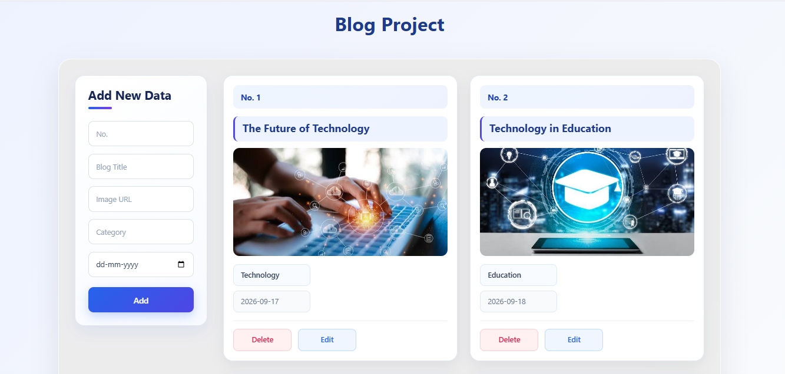

# Blog Project

A simple and responsive **Blog CRUD Application** built using **React.js** and **JSON Server**. This project allows users to add, view, edit, and delete blog data through a clean and user-friendly interface.

## Features

- Add new blog data
- Display all blogs dynamically
- Edit existing blog data
- Delete blog data
- Blog title, image, category, date, and number
- Responsive card-based UI
- Data stored using JSON Server
- CRUD operations using Fetch API
- Form validation using required fields

## Technologies Used

- React.js
- JavaScript
- HTML
- CSS
- JSON Server
- Fetch API
- React Hooks (`useState`, `useEffect`)

## CRUD Operations

| Operation | HTTP Method | Purpose |
|---|---|---|
| Create | POST | Add a new blog |
| Read | GET | Display blog data |
| Update | PUT | Edit an existing blog |
| Delete | DELETE | Remove a blog |

## Project Structure

```text
blog-project/
├── public/
├── src/
│   ├── App.jsx
│   ├── App.css
│   └── main.jsx
├── db.json
├── package.json
└── README.md
```

## Getting Started

### 1. Clone the repository

```bash
git clone https://github.com/bambhaniyadhara14/blog-project.git
```

### 2. Open the project

```bash
cd blog-project
```

### 3. Install dependencies

```bash
npm install
```

### 4. Start React

```bash
npm run dev
```

### 5. Start JSON Server

Open another terminal in the project folder and run:

```bash
npx json-server db.json --watch 3000
```

The API will be available at:

```text
http://localhost:3000/students
```

## How It Works

The React application uses `fetch()` to communicate with the JSON Server API. Existing blog data is loaded using a GET request. New blogs are added using POST, existing blogs are updated using PUT, and blogs are deleted using DELETE.

The `useState` hook manages form fields and application data, while `useEffect` loads the blog data when the application starts. The `map()` method is used to display each blog dynamically as a card.

## Blog Data

Each blog contains:

```json
{
  "no": "1",
  "title": "The Future of Technology",
  "img": "image-url",
  "category": "Technology",
  "date": "2026-09-17",
  "id": "1"
}
```

## 📸 Screenshots



## 🎥 Project Demo

[▶️ Watch Project Demo](https://drive.google.com/file/d/1Dnx2WrKXtUY8frXnm3mGSGSiLae96j9i/view?usp=sharing)

## Author

**Dhara Bambhaniya**

Frontend Developer Fresher


